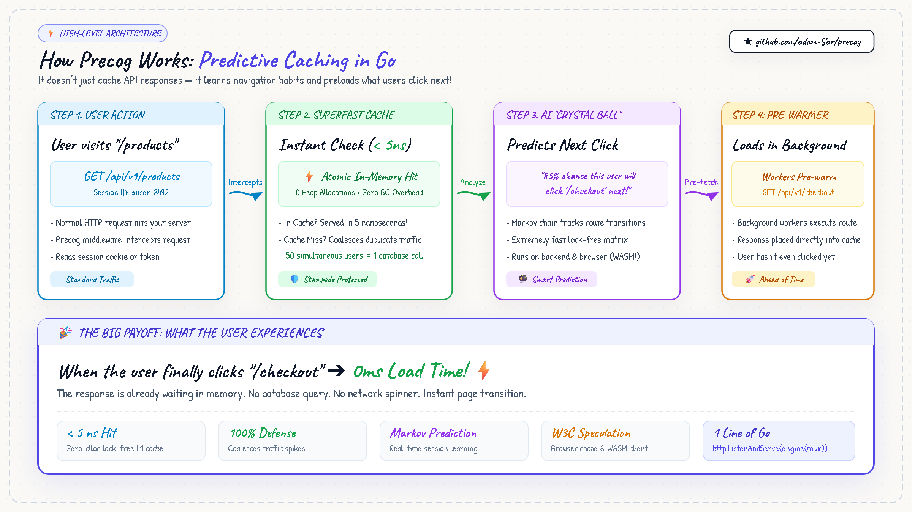

# About Precog

> **"The fastest request is the one that's already finished before the user asks for it."**

---

## What is Precog?

**Precog** is a modern, high-performance HTTP caching middleware for Go (`net/http`, Chi, Echo, Gin). 

Unlike traditional caches that sit passively waiting for requests to arrive, Precog **learns how users navigate your application** using a lightweight, lock-free Markov chain. When a user visits a page or endpoint, Precog predicts where they will navigate next and **speculatively pre-warms** the response in the background.

When the user actually clicks the next link, the data is already waiting in memory — delivering a **0ms perceived latency** experience.

---

## The Problem: Why Traditional Caching Isn't Enough

Modern web APIs face two recurring challenges:

1. **The Cache-Miss Penalty**: Every cache miss forces the user to wait behind a network roundtrip and database query. Even with Redis or Memcached, cross-network serialization and database latency add up to 50ms–300ms of user wait time.
2. **Cache Stampedes (Thundering Herd)**: When a popular cache key expires or traffic spikes, dozens of concurrent requests hit the backend simultaneously, overwhelming databases and spiking CPU usage.

---

## How Precog Solves It: The High-Level Architecture

Here is how Precog handles traffic from the moment a user makes a request to the speculative pre-warming of their next action:



### The 4-Stage Flow:

1. **🌐 Standard User Request**:
   - The user visits an endpoint (e.g., `GET /api/v1/products`).
   - Precog intercepts the request without changing your existing router or handler logic.
   - It identifies the browsing session via a secure session cookie, header, or JWT.

2. **⚡ Ultra-Low-Latency Memory Cache & Stampede Shield**:
   - Precog checks its zero-allocation L1 atomic memory cache in **< 5 nanoseconds**.
   - If it's a hit, the response is returned immediately.
   - If it's a miss, Precog's **request coalescing partition** collapses duplicate concurrent requests: **50 simultaneous users trigger only 1 backend execution**. All 50 users receive the fresh response safely.

3. **🔮 The Markov "Crystal Ball" Predictor**:
   - While serving the response, Precog's lock-free transition matrix records the session step.
   - It calculates transition probabilities in real time: *"85% of users browsing `/products` navigate to `/checkout` next."*
   - Because it uses a contiguous transition matrix, this calculation takes less than 1 microsecond.

4. **🚀 Speculative Pre-Warming**:
   - If confidence exceeds the threshold (e.g. > 65%), background workers quietly execute the predicted route (`/checkout`) ahead of time.
   - The result is pre-populated directly into Precog's in-memory store and browser cache via W3C Speculation Rules.
   - **The Outcome**: When the user clicks `/checkout`, the response is already in memory. **0ms load time. No loading spinners.**

---

## Core Pillars & Principles

| Pillar | How Precog Does It | Why It Matters |
|---|---|---|
| **Speed** | Direct-mapped atomic L1 cache (`~4.5 ns` hit latency) | Faster than Redis, zero GC scanning overhead |
| **Protection** | In-flight request coalescing across 64 shards | Shields your database from traffic spikes and thundering herds |
| **Intelligence** | Contiguous Markov matrix predictor | Predicts user intent on the fly without heavy ML infrastructure |
| **Security First** | Strict RFC 9111 HTTP compliance | Never caches authenticated data, `Set-Cookie`, or private routes |
| **Drop-in Simplicity** | Standard Go `func(http.Handler) http.Handler` | Works with `net/http`, Chi, Echo, Gin, Fiber, or any Go router |

---

## Security & Privacy by Default

Precog is designed from the ground up to prevent data leaks:

- **Strict Method Gating**: Only safe `GET` and `HEAD` requests are cached or coalesced. `POST`, `PUT`, `DELETE`, and `PATCH` always pass straight through.
- **Authentication Isolation**: Any request containing `Authorization` headers, API tokens, or login cookies bypasses shared caching.
- **Zero Cross-User Leaks**: Private user responses are never coalesced across sessions.
- **RFC 9111 Compliance**: Responses with `Set-Cookie`, `Cache-Control: private`, or `Vary: *` are never stored in shared memory.

---

## Quick Example

Integrating Precog into an existing Go server takes less than 5 lines:

```go
package main

import (
    "net/http"
    "time"
    "github.com/adam-Sar/precog"
)

func main() {
    mux := http.NewServeMux()
    mux.HandleFunc("/api/products", ProductsHandler)
    mux.HandleFunc("/api/checkout", CheckoutHandler)

    // Initialize Precog with 5-minute TTL and 60% confidence threshold
    engine, _ := precog.New(precog.Config{
        TTL:                 5 * time.Minute,
        ConfidenceThreshold: 0.60,
    })
    defer engine.Close()

    // Wrap your router with Precog
    http.ListenAndServe(":8080", engine.Handler(mux))
}
```

---

## Social & Assets

- **Repository**: [github.com/adam-Sar/precog](https://github.com/adam-Sar/precog)
- **High-Level Diagram**: [`assets/social/precog-architecture.png`](assets/social/precog-architecture.png)
- **LinkedIn Presentation Visual**: [`assets/social/precog-linkedin-presentation.png`](assets/social/precog-linkedin-presentation.png)
- **Editorial Photography**: [`assets/social/precog-linkedin-photo.jpg`](assets/social/precog-linkedin-photo.jpg)
